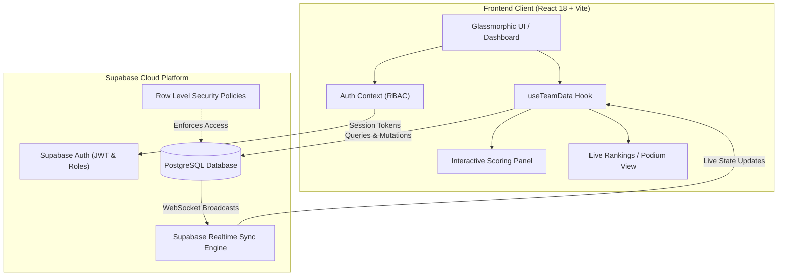

# Dev Dash 2K26 ⚡

> **Real-Time Hackathon Scoring, Evaluation & Leaderboard Platform**

[](https://react.dev/)
[](https://www.typescriptlang.org/)
[](https://vitejs.dev/)
[](https://tailwindcss.com/)
[](https://supabase.com/)
[](LICENSE)

---

## 📌 Overview

**Dev Dash 2K26** is a modern, high-concurrency evaluation and live scoring system engineered specifically for hackathons, design sprints, and competitive coding tournaments. 

Designed to replace chaotic spreadsheets and manual calculation errors, Dev Dash empowers judges with an intuitive, real-time rubric interface while delivering an engaging, live-synced leaderboard with podium standings, score histories, and transparent audit trails.

---

## ✨ Key Features

- **🎯 Standardized 100-Point Evaluation Matrix**: 7 granular judging dimensions designed for comprehensive technical and product appraisal.
- **🔄 Instant Cloud Synchronization**: Real-time multi-judge scoring powered by Supabase with zero latency and optimistic UI updates.
- **🏆 Dynamic Podium & Leaderboard**: Animated rankings, live medal status (Gold, Silver, Bronze), point differentials, and instant sorting.
- **🛡️ Role-Based Access Control (RBAC)**:
  - **Admin / Judge**: Score modification, rubric entry, custom notes, team registration, and audit inspection.
  - **Public / Viewer**: Read-only spectator mode allowing participants and audiences to follow tournament leaderboards live.
- **📜 Immutable Audit Trail**: Detailed `score_history` capturing every score change with evaluator identity, timestamps, previous marks, and delta values.
- **👥 Dynamic Team Directory**: Add, organize, and manage participating teams on-the-fly without rebuilding or redeploying code.
- **🎨 Glassmorphic Cyberpunk Interface**: Ultra-responsive layout with ambient neon lighting, fluid micro-interactions, dark mode aesthetic, and Lucide iconography.

---

## 🏗️ System Architecture



---

## 📊 100-Point Evaluation Rubric

Every participating team is objectively evaluated across seven core criteria:

| Criterion | Max Points | Evaluation Focus |
|:---|:---:|:---|
| **💡 Idea & Understanding** | `15` | Problem clarity, logical approach, and domain comprehension |
| **🚀 Working Demo** | `10` | Functionality works seamlessly during live demonstration |
| **🎨 UI / Design** | `25` | Visual layout, user experience, aesthetic polish, and design system |
| **🧩 Features** | `10` | Depth, utility, and execution quality of implemented features |
| **🌐 Deployment** | `10` | Live availability, public URL accessibility, and stability |
| **🎤 Presentation** | `20` | Articulation, pitch confidence, and team coordination |
| **✨ Creativity & Future Scope** | `10` | Uniqueness, out-of-the-box thinking, and long-term scalability |
| **Total** | **`100`** | **Comprehensive Hackathon Score** |

---

## 🗄️ Database Architecture & Migrations

The database layer utilizes Supabase PostgreSQL with strict Row Level Security (RLS) rules and automated triggers.

### Tables Overview

1. **`public.profiles`**: Stores user authentication data and roles (`admin` or `user`).
2. **`public.evaluations`**: Stores per-team scores (stored as structured `jsonb`), evaluator notes, and modification timestamps.
3. **`public.teams`**: Dynamic directory of hackathon teams.
4. **`public.score_history`**: Audit log recording each score modification, previous value, new value, evaluator email, and timestamp.

### Migration Files

Execute the provided SQL migration scripts sequentially in your **Supabase SQL Editor**:

1. [`supabase_schema.sql`](supabase_schema.sql): Sets up base tables (`profiles`, `evaluations`), user creation trigger (`handle_new_user`), and `is_admin()` function.
2. [`supabase_schema_v2.sql`](supabase_schema_v2.sql): Adds dynamic `teams` table with initial team seeds and creates the `score_history` audit table.
3. [`supabase_schema_v3_public_read.sql`](supabase_schema_v3_public_read.sql): Configures public read access policies so viewers and participants can inspect scores without signing in.
4. [`supabase_schema_v4_history_delete.sql`](supabase_schema_v4_history_delete.sql): Authorizes administrators to purge audit history when resetting tournament stages.

---

## 📁 Repository Directory Structure

```plaintext
dev-dash/
├── public/                     # Static assets and favicons
├── src/
│   ├── components/             # Reusable UI & business components
│   │   ├── ui/                 # Shadcn / Radix UI component library
│   │   ├── AddTeamDialog.tsx   # Team creation modal
│   │   ├── AuthProvider.tsx    # Supabase authentication provider
│   │   ├── CriteriaCard.tsx    # Rubric criterion card
│   │   ├── DashboardHeader.tsx # Top navigation bar & user badge
│   │   ├── JudgeGuidelines.tsx # Judging instructions modal
│   │   ├── LeaderboardModal.tsx# Fast ranking viewer
│   │   ├── ScoreHistoryModal.tsx # Historical score audit viewer
│   │   ├── ScoringPanel.tsx    # Real-time scoring sliders and calculation
│   │   └── TeamSelector.tsx    # Team navigation tabs
│   ├── hooks/                  # Custom React hooks (useTeamData, etc.)
│   ├── lib/                    # Supabase client and utility helpers
│   ├── pages/                  # Page route components
│   │   ├── Index.tsx           # Main Evaluation Dashboard
│   │   ├── Login.tsx           # Authentication portal
│   │   ├── Rankings.tsx        # Tournament Leaderboard & Podium
│   │   └── NotFound.tsx        # 404 Fallback page
│   ├── App.tsx                 # App entry & React Router setup
│   ├── index.css               # Design system tokens and styles
│   └── main.tsx                # React DOM mount point
├── .env.example                # Sample environment configuration
├── components.json             # Shadcn component configuration
├── package.json                # Project dependencies and npm scripts
├── playwright.config.ts        # Playwright end-to-end testing configuration
├── supabase_schema.sql         # Base database schema migration
├── supabase_schema_v2.sql      # Teams & score history migration
├── supabase_schema_v3_public_read.sql # Public read access policies
├── supabase_schema_v4_history_delete.sql # Admin history purge policy
├── tailwind.config.ts          # Tailwind styling system & color palettes
└── vite.config.ts              # Vite build & bundler configuration
```

---

## 🚀 Getting Started

### Prerequisites

- [Node.js](https://nodejs.org/) (v18.0.0 or higher recommended)
- [npm](https://www.npmjs.com/) or [pnpm](https://pnpm.io/)
- A free [Supabase](https://supabase.com/) project

### 1. Clone the Repository

```bash
git clone https://github.com/arjun03125-art/DEV-DASH.git
cd DEV-DASH
```

### 2. Install Dependencies

```bash
npm install
```

### 3. Configure Environment Variables

Create a `.env.local` file in the root directory based on `.env.example`:

```bash
cp .env.example .env.local
```

Fill in your Supabase project credentials:

```env
VITE_SUPABASE_URL=https://your-project-id.supabase.co
VITE_SUPABASE_ANON_KEY=your-supabase-anon-key
```

### 4. Apply Database Migrations

Navigate to your Supabase project dashboard -> **SQL Editor**, and execute the scripts in order:
1. `supabase_schema.sql`
2. `supabase_schema_v2.sql`
3. `supabase_schema_v3_public_read.sql`
4. `supabase_schema_v4_history_delete.sql`

> **Note**: To promote a signed-up user to an **Admin**, execute the following SQL in Supabase:
> ```sql
> UPDATE public.profiles SET role = 'admin' WHERE email = 'your-email@example.com';
> ```

### 5. Start the Development Server

```bash
npm run dev
```

Open [http://localhost:8080](http://localhost:8080) in your browser to access the dashboard.

---

## 🛠️ Available Scripts

| Script | Command | Description |
|:---|:---|:---|
| **Development** | `npm run dev` | Launches the local development server at `http://localhost:8080` |
| **Build** | `npm run build` | Compiles optimized production bundle to the `dist/` folder |
| **Preview** | `npm run preview` | Locally serves the production build for testing |
| **Lint** | `npm run lint` | Runs ESLint across TypeScript and TSX source files |
| **Test** | `npm run test` | Runs unit tests using Vitest |

---

## 🚢 Deployment

### Deploying to Vercel

1. Push your repository to GitHub.
2. Import the repository into [Vercel](https://vercel.com).
3. Set Framework Preset to **Vite**.
4. Configure Environment Variables:
   - `VITE_SUPABASE_URL`
   - `VITE_SUPABASE_ANON_KEY`
5. Click **Deploy**.

---

## 📄 License

This project is open-source and distributed under the [MIT License](LICENSE).
